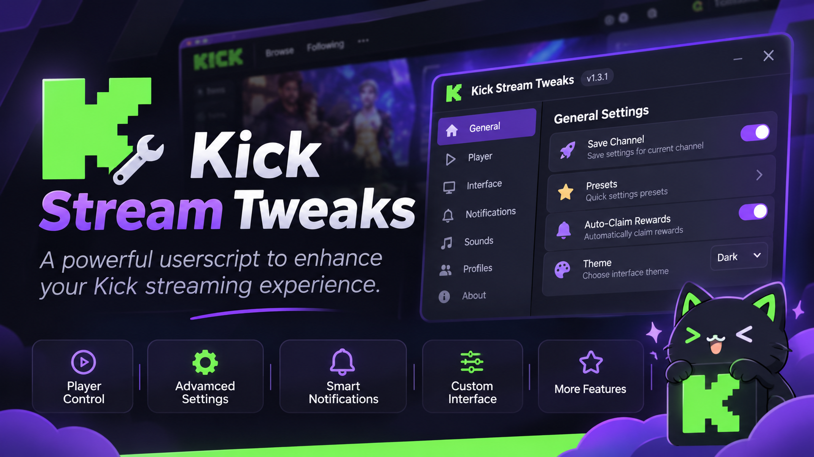

[English](./en_README.md) · [العربية](./ar_README.md) · **Беларуская** · [Български](./bg_README.md) · [Čeština](./cs_README.md) · [Dansk](./da_README.md) · [Deutsch](./de_README.md) · [Ελληνικά](./el_README.md) · [Español](./es_README.md) · [Suomi](./fi_README.md) · [Français](./fr_README.md) · [हिन्दी](./hi_README.md) · [English (India)](./en-in_README.md) · [Hrvatski](./hr_README.md) · [Magyar](./hu_README.md) · [Bahasa Indonesia](./id_README.md) · [Italiano](./it_README.md) · [日本語](./ja_README.md) · [한국어](./ko_README.md) · [Lietuvių](./lt_README.md) · [Latviešu](./lv_README.md) · [Македонски](./mk_README.md) · [Монгол](./mn_README.md) · [Bahasa Melayu](./ms_README.md) · [Nederlands](./nl_README.md) · [Norsk](./no_README.md) · [Polski](./pl_README.md) · [Português](./pt_README.md) · [Română](./ro_README.md) · [Русский](./ru_README.md) · [Slovenčina](./sk_README.md) · [Srpski](./sr_README.md) · [Svenska](./sv_README.md) · [ไทย](./th_README.md) · [Türkçe](./tr_README.md) · [Tiếng Việt](./vi_README.md) · [简体中文](./zh-cn_README.md) · [繁體中文](./zh-tw_README.md)

# Kick Stream Tweaks

**Ваш плэер Kick, запомнены.** Якасць, гучнасць і хуткасць аўтаматычна аднаўляюцца пры кожным патоку з дапамогай хуткай, цалкам лакалізаванай панэлі кіравання.

[Усталяваць](#installation) · [Асаблівасці](#features) · [Карта налад](#settings-map) · [Ярлыкі](#shortcuts) · [Спасылка на функцыю](../docs/be_FUNCTIONS.md) · [Журнал змяненняў](../CHANGELOG/be_CHANGELOG.md) · [Рэлізы](https://github.com/ebayybe/kick-stream-tweaks/releases)

## Асаблівасці

- **Якасць, якая застаецца незаўважанай.** Выберыце жывую трансляцыю і якасць VOD адзін раз; ён прымяняецца да кожнага новага патоку. Калі дакладная якасць адсутнічае, сцэнар вяртаецца да наступнага ніжэйшага (або да Аўта).
- **Гучнасць, якая трымаецца.** Гучнасць і адключэнне гуку аднаўляюцца за паток, з папярэджаннем аб высокай гучнасці і жывым паўзунком, які сінхранізуецца з прайгравальнікам.
- **Паканальныя профілі.** Адкрыйце паток, націсніце **Захаваць гэты канал**, і гэты канал запомніць сваю якасць, гучнасць, хуткасць і гук. Дадайце групу і нататку, прыпыніце захаваныя налады або цалкам выключыце канал з аўтаматызацыі.
- **Хуткія перадусталёўкі.** Эканомія паласы прапускання, лепшая якасць, ціхі прагляд і VOD у адзін клік.
- **Інструменты.** Таймер сну, прагляд у цэнтры ўвагі, паўторная сінхранізацыя прайгравальніка, элементы кіравання макетам старонкі (схаваць чат, згарнуць левае меню) і бяспечны рэжым, які прыпыняе ўсе аўтаматычныя змены.
- **Замарожванне будзільніка.** Уключае гучны сігнал і паказвае апавяшчэнне, калі гулец замірае або паказвае чорны экран, нават калі ўкладка згорнута.
- **Кнопка хуткага атрымання.** Плаваючая кнопка з магчымасцю перацягвання, якая забірае вашу ўзнагароду ў адзін клік. Чатыры дызайну, пяць значкоў або ваш уласны малюнак, рэгуляваны памер і непразрыстасць.
- **Аўтаматычнае патрабаванне ўзнагароджання.** Дадаткова: чакае паведамлення Kick аб узнагароджанні (або правярае па раскладзе), патрабуе тое, што даступна, і зноў закрывае акно (выключана па змаўчанні).
- **Бясшумнае прайграванне.** Заглушае паток без адключэння гуку плэера, таму ён працягвае прайгравацца ў фонавай укладцы. Усталюйце яго глабальна або для кожнага захаванага канала.
- **Абвесткі.** Апавяшчэнні, якія можна перацягваць, змяняць памер і адключаць, а таксама дадатковыя гукавыя эфекты з гучнасцю для кожнай падзеі.
- **Перапрацаваны інтэрфейс.** Згрупаваная бакавая панэль, пошук налад, светлыя і цёмныя тэмы, колеры акцэнтаў, кампактны рэжым, маштабаванне тэксту і высокая кантраснасць.
- **Анімацыя, якой вы кіруеце.** Прагляд у рэжыме рэальнага часу, тры перадусталёўкі і асобныя эфекты адкрыцця, навядзення і індыкатара. Паважае наладу сістэмы "паменшыць рух".
- **38 моваў** са сцягамі. Інтэрфейс адпавядае мове браўзера пры першым запуску і запамінае ваш выбар пасля.
- **Прыватны па дызайне.** Усё застаецца ў вашым браўзеры. Няма тэлеметрыі, няма сеткавых запытаў.

## Ўстаноўка

1. Усталюйце дыспетчар карыстацкіх скрыптаў: [Tampermonkey](https://www.tampermonkey.net/) або [Violentmonkey](https://violentmonkey.github.io/).
2. Адкрыты [`kick-stream-tweaks.user.js`](https://github.com/ebayybe/kick-stream-tweaks/raw/main/kick-stream-tweaks.user.js) і пацвердзіце ўстаноўку.
3. Адкрыйце любы паток на [kick.com](https://kick.com) і націсніце **F2**.

Абнаўленні дастаўляе ваш менеджэр карыстацкіх скрыптаў. Вы таксама можаце паглядзець [Releases](https://github.com/ebayybe/kick-stream-tweaks/releases) старонка.

## Захаванне налад для канала

1. Адкрыйце паток канала, які вы хочаце наладзіць.
2. Адкрыйце панэль (`F2`) і націсніце **Захаваць гэты канал** (на старонцы **Каналы** або з падказкі на старонцы **Прайграванне**). Бягучыя налады якасці, гучнасці, хуткасці і гуку захоўваюцца для гэтага канала.
3. Адрэгулюйце іх у рэдактары пад кнопкай. Яны прымяняюцца аўтаматычна кожны раз, калі вы адкрываеце гэты канал.

Выкарыстоўвайце пераключальнік **Ужыць захаваныя налады на гэтым канале**, каб прыпыніць профіль, не выдаляючы яго, або **Выдаліць**, каб выдаліць яго. Усе захаваныя каналы пералічаны ў раздзеле **Каналы → Захаваныя каналы**, дзе вы можаце шукаць, сартаваць, замацоўваць, групаваць, дадаваць нататкі, ствараць рэзервовыя копіі і аднаўляць іх.

## Карта налад

| Група | старонка | Што ўнутры |
| --- | --- | --- |
| Гулец | **Прайграванне** | Прадусталяваныя налады, якасць у прамым эфіры/VOD, рэзервовы рэжым, гучнасць, адключэнне гуку, папярэджанне аб высокай гучнасці, хуткасць |
| Гулец | **Каналы** | Бягучы профіль канала, захаваныя каналы, пошук, групы, нататкі, рэзервовае капіраванне |
| Гулец | **Інструменты** | Таймер сну, макет старонкі, аўтаматычны запыт узнагарод, кнопка хуткага запыту, прыпынак будзільніка, хуткія дзеянні, прагляд у фокусе |
| Абвесткі | **Апавяшчэнні** | Не турбаваць, памер, працягласць, непразрыстасць, пазіцыя, гісторыя |
| Абвесткі | **Гукі** | Галоўны пераключальнік і гучнасць, пераключальнік для кожнай падзеі, гучнасць і папярэдні прагляд |
| Інтэрфейс | **Знешні выгляд** | Тэма, стыль панэлі, колер акцэнту, шчыльнасць, кантраснасць, размытасць, маштаб тэксту, мова |
| Інтэрфейс | **Анімацыя** | Жывы прагляд, перадусталёўкі, эфекты адкрыцця/навядзення/індыкатара, хуткасць |
| Інтэрфейс | **Ярлыкі** | Гарачыя клавішы меню і гарачыя клавішы дзеянняў |
| сістэма | **Дыягностыка** | Актуальны стан, праверка якасці, праверка канфліктаў, бяспечны рэжым, журнал дзеянняў |
| сістэма | **Дадзеныя і аб** | Экспарт, імпарт, адмена, скід, аднаўленне рэзервовай копіі, спасылкі |

Кожны паўзунок таксама рэагуе на кола мышы, калі вы наводзіце на яго. Выкарыстоўвайце поле пошуку ў верхняй частцы панэлі, каб знайсці любую наладу па назве. Пошук таксама разумее ангельскія назвы, таму ён працуе аднолькава на ўсіх мовах інтэрфейсу, а ўведзеныя там ключы ніколі не трапляюць на старонку.

## Кнопка хуткага патрабавання

Уключыце яго ў **Інструменты → Кнопка хуткага патрабавання на старонцы**. У патоку з'яўляецца маленькая кнопка:

- **Перацягнуць** яго куды заўгодна; яго пазіцыя запомнілася.
- **Націсніце** на яго, каб запатрабаваць сваю ўзнагароду (адкрываецца акно ўзнагароджання, націскаецца *Забраць*, закрываецца акно і вяртаецца да патоку).
- Ён **свеціцца і паказвае чырвоную кропку**, калі з'яўляецца апавяшчэнне аб узнагародзе Kick. Уключыце *Паказваць, толькі калі ўзнагарода даступна*, каб трымаць яе схаванай увесь астатні час.
- Выберыце **стыль** (Orb, Pill, Glass, Flat), убудаваны **значок** або **ваш уласны відарыс** (PNG, JPG, WebP, GIF або SVG да 2 МБ; лепш за ўсё выглядаюць квадратныя відарысы з празрыстым фонам), **памер** і **непразрыстасць**. Жывы папярэдні прагляд паказвае кожную змену.

Кнопка асобная ад *Аўтаматычнае патрабаванне ўзнагарод*, так што вы можаце патрабаваць уручную, аўтаматычна або абодва.

## Ярлыкі

| Дзеянне | Па змаўчанні |
| --- | --- |
| Адкрыць / зачыніць панэль | `F2` |
| Пераключыць апавяшчэнні | `Alt+N` |
| Пераключыць чат | `Alt+C` |
| Пераключыць левае меню | `Alt+S` |
| Выгляд у цэнтры ўвагі | `Alt+F` |
| Скінуць якасць | `Alt+Q` |
| Аднавіць гучнасць | `Alt+V` |

Кожны ярлык можна аднавіць у **Ярлыкі**. Прывязкі ідуць за фізічнай клавішай, таму працуюць на любой раскладцы клавіятуры.

## Мовы

Арабская, беларуская, балгарская, кітайская (спрошчаная), кітайская (традыцыйная), харвацкая, чэшская, дацкая, галандская, англійская, англійская (Індыя), фінская, французская, нямецкая, грэчаская, хіндзі, венгерская, інданезійская, італьянская, японская, карэйская, латышская, літоўская, македонская, малайская, мангольская, нарвежская, польская, партугальская, румынская, руская, сербская, славацкая, іспанская, шведская, тайская, турэцкая і в'етнамская.

## Ліквідацыю непаладак

- **Якасць не ўжываецца.** Адкрыйце **Дыягностыку**, націсніце *Абнавіць дыягностыку*, каб прасканаваць прапановы якасці Kick, затым *Праверце выбраную якасць*. Калі канал выключаны або ўключаны бяспечны рэжым, пра гэта паведамляецца ў радку стану.
- **Узнагароды не запытваюцца.** Аўтаматычнае патрабаванне адключана па змаўчанні. Уключыце яго ў **Інструменты → Узнагароды** і паспрабуйце *Запатрабаваць зараз*. Гэта працуе толькі на жывых каналах, у той час як укладка бачная, і вы не пішаце ў чаце. У рэжыме *апавяшчэння* скрыпт рэагуе на ўласны банэр узнагароды Kick.
- **Бясшумнае прайграванне і гук.** Бясшумнае прайграванне накіроўвае відэа праз аўдыё механізм браўзера з нулявым узмацненнем. Калі сайт блакуе гэта, панэль паведамляе пра гэта, і звычайны гук застаецца некранутым.
- **Нешта паводзіць сябе дзіўна.** Запусціце *Праверыць канфлікты* або выкарыстайце *Скід раздзела* на адпаведнай старонцы.
- **Пасля абнаўлення налады выглядаюць няправільна.** Выкарыстоўвайце **Дадзеныя і аб → Адмяніць** або **Аднавіць рэзервовую копію**.
- **Знайшлі памылку?** Націсніце *Капіяваць дыягностыку* і далучыце яе да a [new issue](https://github.com/ebayybe/kick-stream-tweaks/issues).

## Прыватнасць

Налады і профілі каналаў захоўваюцца ў лакальным сховішчы вашага браўзера на kick.com. Сцэнар ніколі нікуды не адпраўляе дадзеныя і не запытвае дадатковых дазволаў (`@grant none`).

## Уклад

Праблемы і запыты на выцягванне вітаюцца. Сцэнар уяўляе сабой адзіны самадастатковы файл, таму для спробы змены: рэдагавання не патрабуецца этап зборкі `kick-stream-tweaks.user.js` і перазагрузіце старонку.

## Ліцэнзія

[MIT](./LICENSE)
